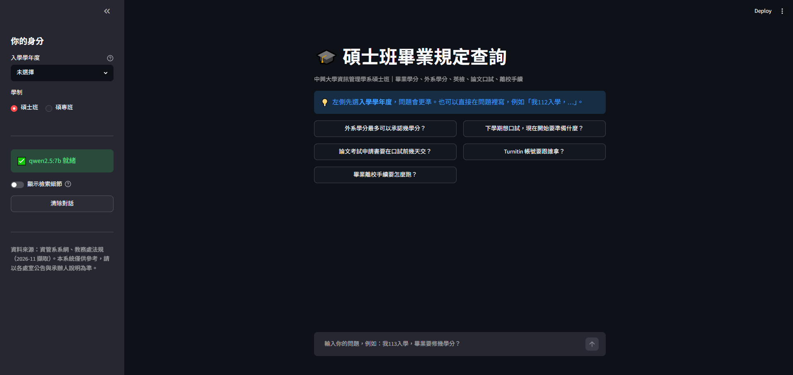
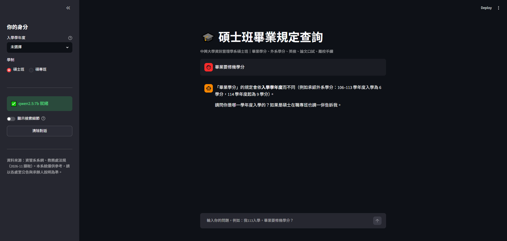
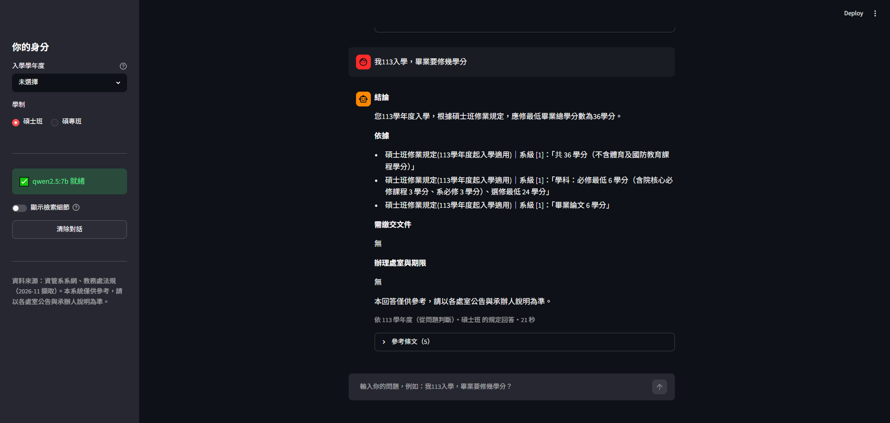
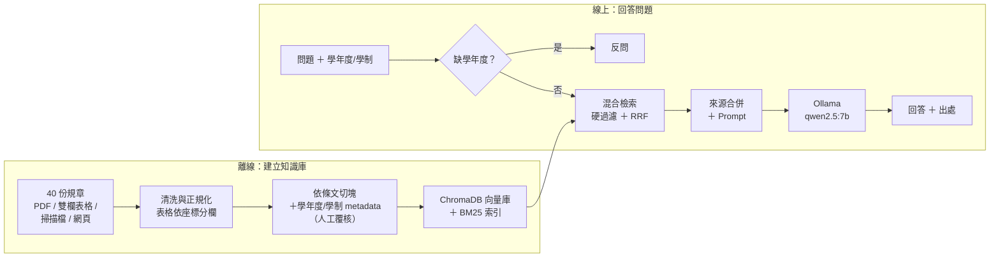

# 🎓 Graduation Regulations RAG Assistant

> 中興資管碩士班 畢業規定查詢

<p align="center">
  <b>把散落在系網、教務處、註冊組的 40 份畢業規章整理成問答系統<br/>
  依「入學學年度 × 學制」回答，每個答案附條文原句與可點回原文的出處<br/>
  全程本機執行，不需任何付費 API</b>
</p>

---

## 📸 系統預覽

<table>
  <tr>
    <td>
      
      <p align="center"><em>▲ 首頁：側欄選入學學年度與學制，或直接點範例問題</em></p>
    </td>
  </tr>
  <tr>
    <td>
      
      <p align="center"><em>▲ 沒給學年度、但答案會因學年度而異 → 系統反問，不猜</em></p>
    </td>
  </tr>
  <tr>
    <td>
      
      <p align="center"><em>▲ 問句帶學年度 → 依該年度規定回答，「依據」逐條引用條文原句</em></p>
    </td>
  </tr>
</table>

---

## ❓ 為什麼不是一般的 RAG 就好

同一個問題，答案會因**入學學年度與學制**而不同：

| 問題 | 答案 |
|---|---|
| 外系學分最多承認幾學分？ | 106–113 入學 **6** 學分；114 起 **9** 學分；碩專班 **0** 學分 |
| 英檢什麼時候要過？ | 110 以前：畢業前；111 起：論文考試申請前；碩專班：不用 |

13 個學年度版本的明細表文字幾乎一樣。只比語意相似度的 RAG 會**穩定地拿錯版本**，而且答案看起來很正確。所以這個系統把學年度與學制當成**檢索的硬過濾條件**，缺了就反問。

---

## ✨ 功能特色

| 功能 | 描述 |
|---|---|
| 🎯 **依身分過濾** | 學年度、學制作為 metadata 硬過濾，不會拿別的年度的規定湊數 |
| 🙋 **不確定就反問** | 問到依學年度而異的主題卻沒給學年度時先反問；回「114」即自動重答原問題 |
| 🔍 **混合檢索** | bge-m3 向量 ＋ BM25 關鍵字，以 RRF 融合；同時擅長口語問法與條次、表單代碼 |
| 📑 **可查證的回答** | 固定四段：結論／依據／需繳交文件／辦理處室與期限；「依據」逐條引用原句 |
| 🔗 **出處逐段列出** | 參考條文列出用到的每一段，連回原始 PDF 或網頁 |
| 🚫 **不編造** | 規章沒寫的事明確說「未涵蓋」並轉介處室；不存在的表單直接說沒有 |
| 📊 **可量化評估** | 自建 50 題評估集（含對抗性與不可答題），每次改動都能比較前後數字 |
| 💻 **完全本機** | Ollama `qwen2.5:7b`，免 API key、資料不出本機；可一行設定切換 Claude API |

---

## 🏗️ 系統架構



完整的離線／線上／評估流程圖與每一步的做法，見 [技術細節](docs/技術細節.md)。

---

## 🔧 技術實現重點

### 1. 學年度／學制 metadata 硬過濾

```python
# src/retrieve.py — 檢索前先限定「適用於這個人」的條文
def build_where(year: int | None, program: str | None) -> dict | None:
    conds: list[dict] = []
    if year is not None:
        conds += [{"year_from": {"$lte": year}}, {"year_to": {"$gte": year}}]
    if program in PROGRAM_FLAG:
        conds.append({"$or": [{PROGRAM_FLAG[program]: True}, {"prog_all": True}]})
    if not conds:
        return None
    return conds[0] if len(conds) == 1 else {"$and": conds}
```

- 每塊的適用學年度**不全信自動抽取**：檔名寫 103 的明細表，表頭實際是 104 起適用，靠人工覆核表修正
- BM25 那一路用等價的 Python 函式過濾，兩路過濾條件一致
- 適用範圍同時寫進被 embed 的文字（`【適用】113 學年度入學之碩士班`），向量本身也會偏向對的版本

### 2. 向量 ＋ BM25 混合檢索，RRF 融合

```python
# src/retrieve.py
def search(self, query: str, year: int | None = None, program: str | None = "碩士班",
           k: int = TOP_K, n_candidates: int = N_CANDIDATES) -> list[Hit]:
    d = self.dense(query, year, program, n_candidates)    # bge-m3 + ChromaDB
    s = self.sparse(query, year, program, n_candidates)   # BM25 + jieba
    hits: dict[str, Hit] = {}
    for rank, cid in enumerate(d, 1):
        h = hits.setdefault(cid, Hit(cid, 0.0, chunk=self.chunks[cid]))
        h.dense_rank, h.score = rank, h.score + 1 / (RRF_K + rank)
    for rank, cid in enumerate(s, 1):
        h = hits.setdefault(cid, Hit(cid, 0.0, chunk=self.chunks[cid]))
        h.bm25_rank, h.score = rank, h.score + 1 / (RRF_K + rank)
    return sorted(hits.values(), key=lambda h: -h.score)[:k]
```

- 向量擅長口語與同義詞（「口試委員」↔「考試委員」），BM25 擅長條次、數字、英文（Turnitin、多益、第四條）
- jieba 加入 50 個法規自訂詞（學位考試、抵免學分、碩士在職專班…），避免中文 BM25 斷詞斷錯

### 3. 缺學年度就反問，不猜

```python
# src/slots.py — 用規則判斷，可預期、可測、不花錢
YEAR_DEPENDENT = {
    "畢業學分": r"畢業.{0,4}學分|總學分|幾學分|最低.{0,2}學分|要修多少",
    "外系學分": r"外系|外所|校際選課|管理學院.{0,6}課",
    "英文門檻": r"英檢|英文|多益|托福|TOEIC|TOEFL|IELTS|全英",
    # ...共 8 個依學年度而異的主題
}

@property
def needs_year(self) -> bool:
    return self.year is None and self.program == "碩士班" and bool(self.year_topics)
```

- 學年度來源優先順序：問句中寫的 ＞ 對反問的回覆 ＞ 側欄
- 主題清單刻意收窄：「抵免成績要幾分」不分學年度，不該反問
- 反問時不檢索、不呼叫 LLM，直接回覆並舉例說明為什麼要問

### 4. 檢索後依條文合併（small-to-big）

```python
# src/generate.py — 小塊檢索比較準；送給模型時，同一節的多塊合併成一個來源
def group_hits(hits: list) -> list[dict]:
    groups: dict[tuple, dict] = {}
    for h in hits:
        key = section_key(h.chunk)            # (文件, 節)
        g = groups.setdefault(key, {"chunk": h.chunk, "section": key[1], "parts": []})
        g["parts"].append(h.chunk)
    ...                                        # 內文標出（第 k/n 段），介面逐段列出出處
```

- 長的流程頁一節會被切成 4 塊；不合併的話，5 個來源裡 4 個長得一樣
- 檢索與評估仍以塊為單位；合併只在檢索之後、只合併有被撈到的塊
- 搭配 `select_hits` 從前 10 個候選中湊滿 5 個**不同的節**

---

## 📊 成果

在自建的 50 題評估集上（含對抗性題目與不可答題目）：

**檢索與流程控制**

| 指標 | 結果 |
|---|---|
| 檢索 hit@5（context 內至少有一個正確條文） | **0.95** |
| 學年度／學制過濾外洩 | **0 次** |
| 學年度抽取正確 | **17 / 17** |
| 應反問的題目有反問／誤反問 | **2 / 2**／**0** |
| 混合檢索 vs 純 BM25（冒煙測試 15 題） | 15/15 vs 12/15 |

**端到端回答（本機 `qwen2.5:7b`，baseline）**

| 指標 | 結果 |
|---|---|
| 行為正確率（該答就答、該反問就反問、該拒答就拒答） | **0.90**（45 / 50） |
| 要點涵蓋率 | 0.62 |
| 幻覺（無依據的具體結論） | 3 / 50 題 |
| 不存在的表單、規章沒寫的金額 | 3 / 3 題沒有編造 |
| 速度（GTX 1660 Super 6GB） | 檢索 0.19 秒，生成每題約 23 秒 |

**目前的瓶頸**
- 檢索面：需要同時引用系規與校規的多跳題，recall 只有 0.55；一條塞很多款的條文容易排不進前 5。
- 生成面：即使正確條文全部撈到，7B 的要點涵蓋率也只有 0.69，常抓到主要數字卻漏掉細節；「辦理處室」常寫「無」。

完整數字、失敗案例分析與結論見 [評估報告](docs/評估報告.md)。

---

## 🛠️ 技術棧

| 類別 | 技術 |
|---|---|
| **文件解析** | PyMuPDF（依座標拆雙欄表格）、人工轉錄掃描檔 |
| **資料結構** | Pydantic（chunk schema 含適用學年度、學制、處室、條次） |
| **向量檢索** | `BAAI/bge-m3`（sentence-transformers）、ChromaDB |
| **關鍵字檢索** | rank-bm25、jieba ＋ 法規自訂詞典 |
| **融合** | Reciprocal Rank Fusion、small-to-big 來源合併 |
| **生成** | Ollama `qwen2.5:7b`；可切換 Anthropic Claude API |
| **介面** | Streamlit |
| **評估** | 自建評估腳本：hit@5、recall@5、MRR、要點涵蓋、拒答、幻覺 |

---

## 📦 專案結構

```
├── app.py                      # 🖥️ Streamlit 聊天介面
├── download_sources.py         # ⬇️ 依 sources.csv 下載原始規章
├── src/
│   ├── ingest.py               # 📄 PDF / Markdown → 正規化 Markdown（表格分欄）
│   ├── chunker.py              # ✂️ 依條文切塊、metadata、人工覆寫
│   ├── index.py                # 🗂️ ChromaDB ＋ BM25 索引
│   ├── retrieve.py             # 🔍 硬過濾 ＋ 混合檢索 ＋ RRF
│   ├── slots.py                # 🙋 抽學年度／學制、決定是否反問
│   ├── generate.py             # ✍️ 來源合併、prompt、呼叫 LLM、引用整理
│   ├── pipeline.py             # 🔗 answer() 主入口
│   ├── evaluate.py             # 📊 檢索層／端到端評估
│   ├── config.py               # ⚙️ 路徑、模型、檢索參數
│   └── schema.py               # 🧱 Chunk 資料結構
├── data/
│   ├── sources.csv             # 47 筆來源清單
│   ├── doc_overrides.csv       # 人工覆核的文件適用學年度
│   ├── chunk_overrides.csv     # 人工覆核的單一 chunk 適用學年度
│   ├── jieba_userdict.txt      # 法規自訂詞典
│   ├── manual/                 # 掃描檔人工轉錄稿
│   ├── processed/              # 正規化後的 Markdown
│   └── chunks.jsonl            # 378 個 chunk
├── eval/
│   ├── questions.jsonl         # 50 題評估集
│   ├── smoke_queries.jsonl     # 15 題檢索冒煙測試
│   └── results/                # 每次評估的輸出
├── docs/
│   ├── 技術細節.md              # 問題背景、細節流程圖、資料處理、prompt 設計
│   ├── 評估報告.md              # 評估方法、完整數字、失敗案例、結論
│   ├── 設計規劃.md              # 動工前的規劃文件
│   └── images/
```

---

## 🚀 快速開始

### 環境需求

- Python 3.11+
- [Ollama](https://ollama.com)
- 建議有 GPU 給 Ollama 使用（開發機為 GTX 1660 Super 6GB）；檢索在 CPU 即可

### 安裝

```bash
git clone <repo-url>
cd <repo>
pip install -r requirements.txt
ollama pull qwen2.5:7b          # 約 4.7 GB；bge-m3（約 2 GB）會在第一次執行時自動下載
```

### 建立索引（只需做一次）

Repo 已附上處理好的 `data/processed/` 與 `data/chunks.jsonl`，只要建索引：

```bash
python -m src.index             # 建 ChromaDB 向量庫＋BM25 索引
```

想從原始文件完整重建（規章 PDF 不隨 repo 散布，依 `sources.csv` 下載）：

```bash
python download_sources.py      # 下載規章 PDF 到 data/raw/
python -m src.ingest            # 清洗、表格分欄、切節 → data/processed/
python -m src.chunker           # 切塊＋metadata → data/chunks.jsonl
python -m src.index
```

### 啟動

```bash
streamlit run app.py            # http://localhost:8501（只在本機開放）
```

命令列：

```bash
python -m src.pipeline "我112入學，外系學分可以抵幾學分？"
python -m src.pipeline "碩專班最低畢業學分" --dry      # 不呼叫 LLM，印出檢索結果與完整 prompt
```

### 評估

```bash
python -m src.evaluate                       # 檢索層，約 10 秒
python -m src.evaluate --gen --judge none    # 50 題端到端，約 20 分鐘，輸出人工覆核表
```

### 改用 Claude API（可選）

`src/config.py` 設 `LLM_PROVIDER = "claude"`，將 `.env.example` 複製為 `.env` 並填入 `ANTHROPIC_API_KEY`。

---

## 🔮 未來規劃

- [ ] 條文內有「一、二、三、」款項時依款切塊（改善一條講很多事的條文排名）
- [ ] 不分學年度的問題，同系列文件只保留最新一版，避免 13 版明細表互相擠位子
- [ ] 加入 reranker（`bge-reranker-v2-m3`），改善多跳題 recall
- [ ] 「辦理處室」由程式從來源的主責欄位帶出，不交給模型寫
- [ ] 檢索分數過低時直接回答「未涵蓋」，避免不可答題被相近條文帶偏
- [ ] 依「文件＋條次」在程式中校正模型標錯的來源編號
- [ ] 以同學實際問過的問題擴充評估集

---

## 📄 資料來源聲明

本專案使用之規章文件版權屬國立中興大學及其各單位所有，僅作為研究與作品展示用途。資料擷取於 2026 年 11 月，規定內容以學校最新公告與承辦人說明為準。
