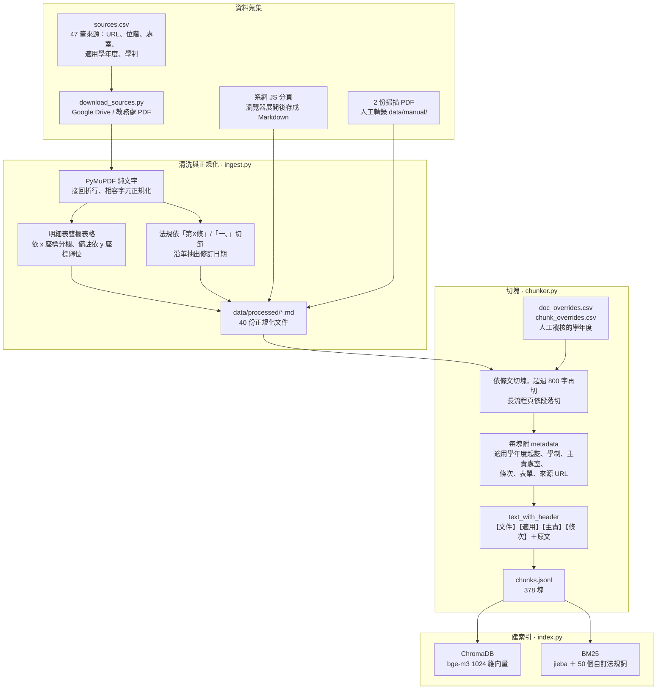
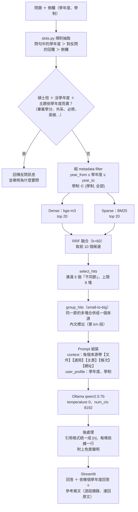

# 技術細節

> 回到 [README](../README.md)｜評估與結論見 [評估報告](評估報告.md)

## 目錄

1. [問題背景](#1-問題背景)
2. [離線：建立知識庫](#2-離線建立知識庫)
3. [線上：回答一個問題](#3-線上回答一個問題)
4. [Prompt 設計](#4-prompt-設計)
5. [資料結構](#5-資料結構)

---

## 1. 問題背景

### 規定分散在哪裡

| 要查的事 | 規定在哪裡 | 誰負責 |
|---|---|---|
| 最低畢業學分、必修、外系學分上限 | **各學年度**的「畢業條件明細表」（101–115 共 13 版 PDF） | 資管系系辦 |
| 修業年限、抵免、英檢門檻 | 系修業準則 ＋ 校學則、校抵免辦法 | 系辦 ＋ 教務處 |
| 口試申請期限、委員資格 | 系修業準則 ＋ 校學位考試細則（**兩者期限不同**） | 系辦 → 註冊組 |
| 學術倫理、Turnitin、離校手續 | 系網流程頁 ＋ 校級要點 | 指導教授／教務處／圖書館 |

共 47 筆來源（系級 23、校級 22、校外 2），其中 40 份是規章內容，格式有 PDF、雙欄表格、掃描檔與網頁。

### 同一個問題，答案因人而異

| 問題 | 答案 |
|---|---|
| 外系學分最多承認幾學分？ | 106–113 學年度入學：**6** 學分；114 起：**9** 學分；碩專班：**0** 學分 |
| 最低畢業學分？ | 110 入學 39、113 入學 36、碩專班 35 |
| 英檢什麼時候要過？ | 110 以前：畢業前；111 起：**論文考試申請前**；碩專班：不用 |

13 個學年度版本的明細表文字幾乎一樣，只比語意相似度的 RAG 會穩定地拿錯版本回答，而且答案看起來很正確。因此**學年度與學制是檢索的硬過濾條件，不是回答時的附註**，整個架構都繞著這點設計。

### 需求

1. 依入學學年度與學制回答，不拿別的年度的規定湊數
2. 沒給學年度、但答案會因學年度而異時 → 反問，不猜
3. 每個答案附條文原句與出處（可點回原始 PDF）
4. 規章沒寫的事，明確說「未涵蓋」並轉介處室，不編造表單、期限、處室
5. 有固定評估集，能量化每次改動的效果
6. 免費、本機執行

---

## 2. 離線：建立知識庫



### 關鍵處理

| 問題 | 做法 |
|---|---|
| 檔名寫 103 的明細表，表頭實際是「104 學年度起入學適用」 | 學年度 metadata 不全信自動抽取：ingest 比對表頭與 `sources.csv`，不一致就提示；人工確認後寫進 `doc_overrides.csv` |
| 條文中提到「105 學年度入學者 5 小時、106 以後 6 小時」 | 只標記為待覆核，不自動覆寫整塊的適用年度 —— 這種句子是在一條規定裡區分新舊制，覆寫會讓其他年度的人查不到 |
| 明細表是「左欄項目、右欄備註」的雙欄表，通用 parser 會把兩欄文字交錯 | 依 x 座標拆欄，右欄備註依 y 座標歸給對應項目；學分數欄位接回科目名稱後面 |
| PDF 中的「六」是相容字元 U+F9D1，導致第六項整個消失 | 正規化 CJK 相容字元與康熙部首 |
| 2 份明細表是掃描檔 | 人工轉錄到 `data/manual/`，chunk 標記 `manual_transcription` 方便日後對照 |
| 「本辦法經…會議通過後實施」這類條文 | 整條只有這一句時才刪；早期版本用部分比對，誤刪了兩條真正的規定 |
| 同一份規定在不同年度版本中文字完全相同 | 依（內容雜湊、適用年度、學制）去重 |

**適用範圍寫進被 embed 的文字**：每塊實際拿去 embed 的是 `text_with_header`

```
【文件】碩士班研究生畢業條件明細表(113學年度起入學適用)
【適用】113 學年度入學之碩士班
【主責】資管系系辦
【條次】五、承認外系學分
---
<條文原文>
```

使用者問「112 入學…」時，向量本身就會偏向對的版本，不只靠 filter。

---

## 3. 線上：回答一個問題



### 3.1 抽取學年度與學制（`slots.py`）

用**規則**而不是 LLM：學年度的寫法有限（「112入學」「我是113的」「111學年度」），規則可預期、可測、不花錢。

- 優先順序：問句中寫的 ＞ 對反問的回覆 ＞ 側欄
- 反問條件：碩士班 ＋ 沒有學年度 ＋ 問到依學年度而異的主題（畢業學分、外系、必修、補修、英文門檻、大學部課程、學術倫理時數、資訊能力）
- 碩專班不反問：碩專班準則不分學年度
- 主題清單刻意收窄：「抵免」本身不算（抵免的成績門檻、申請期限不分學年度），否則「抵免成績要幾分」會被誤反問
- 反問時不檢索、不呼叫 LLM

### 3.2 混合檢索（`retrieve.py`）

| | Dense | Sparse |
|---|---|---|
| 工具 | ChromaDB（cosine）＋ `BAAI/bge-m3` | `rank_bm25` ＋ jieba |
| 索引的文字 | `text_with_header` | 文件標題 ＋ 條文原文 |
| 擅長 | 口語、同義（「口試委員」↔「考試委員」） | 專有名詞、數字、英文（多益、Turnitin、第四條） |

兩路各取前 20 名（都先套用學年度／學制過濾），以 Reciprocal Rank Fusion（k=60）融合。BM25 那一路用和 Chroma `where` 等價的 Python 函式過濾，兩邊的過濾條件保證一致。

### 3.3 來源合併（small-to-big）

長的流程頁會被切成多塊，例如「一、提出論文考試申請前的準備」切成 4 塊。如果直接把 5 個最相關的塊送給模型，常常 4 個都來自同一節：模型和使用者看到的是 4 個長得一樣的來源，真正的來源數只剩 2 個。

- **檢索與評估仍以 chunk 為單位**（小塊的向量比較準）
- 檢索後 `select_hits` 從前 10 個候選中湊滿 5 個不同的節（最多 8 塊，避免超出 7B 的 context）
- `group_hits` 把同一節**有被檢索到的**塊合併成一個來源，內文標出（第 k/n 段）
- 介面在每個來源底下逐段列出「第 k/n 段」與摘錄，出處仍精確到塊

---

## 4. Prompt 設計

System prompt 以「只能依據 context 回答」為基礎，再加上**評估集中實際遇到、需要明講的規則**：

| 規則 | 對應的真實案例 |
|---|---|
| 系規比校規嚴時以系規為準，並說明校規是全校上限 | 校選課辦法：大學部課程 6 學分；系明細表：3 學分 |
| 系、校各訂期限時兩個都講，說明實際要照哪個 | 系：口試前 30 天申請；校：20 天前 |
| 同一份文件前後矛盾要指出 | 114 明細表第五項寫外系 9 學分，第六項備註還寫 6 學分 |
| 條文自己區分新舊制時，挑出適用的那句 | 學術倫理：105 入學 5 小時、106 以後 6 小時 |
| 規章寫到哪答到哪，不延伸 | 「配偶不得擔任口試委員」≠「女朋友不得擔任」 |
| 只有相近條文時，不能拿來當答案 | 問碩專班外系學分，context 只有校際選課 6 學分 |
| 沒出現過的表單直接說沒有 | 「G9-3 表要交去哪？」 |
| 問句帶錯誤前提時先糾正 | 「Turnitin 口試完再做就好了對吧？」 |

回答格式固定為四段：**結論／依據／需繳交文件／辦理處室與期限**。「依據」每條一行，格式為 `文件 條次：「條文原句」[n]`。

**交給程式、不交給模型的事**（7B 模型做不穩）：

- 免責聲明由程式附加：寫在 prompt 裡要模型「最後一行固定寫」，7B 會連指令前綴一起照抄
- 引用格式整理：模型寫的「【依據1】根據【來源1】，…」由 `tidy_citations()` 統一成 `[1]`，並讓每條依據自成一行

**LLM 切換**：`src/config.py` 的 `LLM_PROVIDER` 在 `"ollama"`（預設）與 `"claude"` 之間切換。Claude 路徑使用 `claude-opus-5-5`、system prompt 加 `cache_control`、處理 `refusal`；檢索層與評估完全不用改。

---

## 5. 資料結構

每個 chunk（`src/schema.py`，Pydantic）：

| 欄位 | 用途 |
|---|---|
| `chunk_id`, `doc_id`, `title` | 識別 |
| `text`, `text_with_header` | 原文；加上下文前綴、實際拿去 embed 的版本 |
| `level` | 校級／系級／作業層 |
| `applicable_year_from`, `applicable_year_to` | **過濾用**：適用入學學年度起訖，`None` 表示不限 |
| `applicable_program` | **過濾用**：碩士班／碩專班／全部 |
| `responsible_office`, `article_no`, `section_path`, `forms` | 回答用：主責處室、條次、表單 |
| `source_url`, `revision_date` | 溯源 |
| `year_mentions`, `year_source` | 覆核用：條文中提到的學年度、適用年度的來源（自動／文件覆寫／chunk 覆寫） |

ChromaDB 的 metadata 不能存 `None` 與 list：學年度以 `0`／`9999` 表示不限，學制拆成 `prog_master`、`prog_exec`、`prog_all` 三個布林值。
