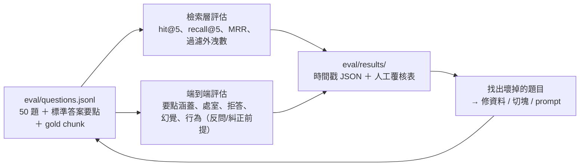

# 評估報告

> 回到 [README](../README.md)｜架構與做法見 [技術細節](技術細節.md)

## 目錄

1. [評估方法](#1-評估方法)
2. [檢索層](#2-檢索層)
3. [學年度反問](#3-學年度反問)
4. [端到端生成](#4-端到端生成)
5. [失敗案例：檢索錯，生成就錯](#5-失敗案例檢索錯生成就錯)
6. [結論](#6-結論)
7. [已知限制與下一步](#7-已知限制與下一步)

---

## 1. 評估方法

### 評估集（50 題）

| 來源 | 題數 | 例子 |
|---|---|---|
| 從條文反向出題 | 20 | 113 學年度入學的碩士班，最低畢業學分是多少？ |
| 學生口吻的實際問題 | 15 | 我六月口試，可是八月底前來不及離校，怎麼辦？ |
| 對抗性題目 | 10 | 學年度陷阱、碩士班／碩專班混淆、錯誤前提、不存在的表單、系校規定衝突 |
| 規章未涵蓋（應拒答） | 5 | 宿舍、兵役、口試費金額、學雜費、出國交換 |

| 題型 | 說明 |
|---|---|
| T1 事實查詢 | 最低畢業學分是多少 |
| T2 條件判斷 | 我 112 入學，外系學分上限是多少 |
| T3 流程導引 | 下學期要口試，現在起要做什麼 |
| T4 多跳 | 需要同時引用系規與校規 |
| T5 窗口定位 | 這份表單交去哪 |
| T6 不可答 | 規章未涵蓋，正解是拒答並轉介 |

每題標註：`gold_chunk_ids`（正確條文）、`acceptable_chunk_ids`（也算對、但不計入 recall）、`gold_answer_points`（標準答案要點）、`gold_office`（正確處室）、`expected_behavior`（回答／反問／糾正前提／否認表單／拒答）。

**對抗性題目中的陷阱**

| 題目 | 陷阱 |
|---|---|
| 同一題不同入學年 | 答案不同（39／35／36 學分；外系 6／9） |
| 修大學部課程上限 | 校選課辦法寫 6 學分，系明細表限 3 學分 → 系規優先 |
| 口試申請期限 | 系：30 天前；校：20 天前（送達註冊組的最遲期限） |
| 「英檢畢業前通過就好」 | 110 以前的規定；111 起改為論文考試申請前 |
| 114 學年度外系學分 | 明細表本身前後矛盾：第五項 9 學分，第六項備註還寫 6 學分 |
| 碩專班外系學分、英檢 | 上限 **0** 學分、不需英檢 —— 套用碩士班答案就錯 |
| 「女朋友可以當口試委員嗎」 | 規章只禁配偶與三等親，答案不能自行延伸 |

### 指標

| 層 | 指標 | 算法 |
|---|---|---|
| 檢索 | hit@5 | 送進 LLM 的 context 中至少有一個 gold 或 acceptable |
| 檢索 | recall@5 | gold 有幾成進入 context（多跳題要全撈到才完整） |
| 檢索 | MRR | 第一個正確條文名次的倒數 |
| 檢索 | 過濾外洩 | context 中違反題目學年度／學制的塊數 |
| 生成 | 要點涵蓋率 | 回答涵蓋幾成 `gold_answer_points` |
| 生成 | 窗口正確率 | 回答提到的處室符合 `gold_office` |
| 生成 | 適當拒答率 | 應拒答、應否認表單的題目做對的比例 |
| 生成 | 幻覺數 | 回答中出現標準答案與 context 都沒有支持的數字、期限、表單、處室 |
| 生成 | 行為正確率 | 是否做對 `expected_behavior` |

---

## 2. 檢索層

42 題有標準條文（另 8 題是反問或拒答題）。以下是 pipeline 實際送進 LLM 的 context（5 個不同節，平均 5.5 塊）。

| 指標 | 數值 |
|---|---|
| **hit@5** | **0.95** |
| recall@5 | 0.73 |
| MRR | 0.70 |
| **過濾外洩** | **0** |
| 檢索速度 | 0.19 秒／題（CPU） |

| 題型 | 題數 | recall@5 |
|---|---|---|
| T1 事實查詢 | 11 | 0.73 |
| T2 條件判斷 | 14 | 0.75 |
| T3 流程導引 | 6 | 0.79 |
| T4 多跳 | 7 | **0.55** |
| T5 窗口定位 | 4 | 0.92 |

| 題目來源 | 題數 | hit@5 | recall@5 |
|---|---|---|---|
| 從條文出題 | 20 | 1.00 | 0.76 |
| 學生口吻 | 15 | 0.93 | 0.75 |
| **對抗性** | 7 | **0.71** | **0.50** |

（來源分組為單純 top 5 的數字；改成「5 個不同節」後整體 hit@5 從 0.93 升到 0.95、recall@5 從 0.71 升到 0.73。）

**混合檢索的效果**（15 題手動冒煙測試）：純向量 15/15、純 BM25 12/15、混合 15/15。冒煙測試是邊看邊調的，50 題評估集的數字才是比較誠實的成績。

### 撈不到的原因

| 原因 | 例子 | 候選修法 |
|---|---|---|
| 不分學年度的問題，被 13 版明細表的同一項洗版 | 「碩士班最多可以讀幾年？」top 5 全是各年度明細表的同一句，系準則與校章程排不進來 | 同一系列文件只留最新一版，或依文件去重 |
| 一條條文塞很多款，向量被稀釋 | 碩專班準則第四條一口氣講修課、大學部、外系、補修、英文、選課六件事，dense 只排第 11 | 條文內有「一、二、三、」時依款切塊 |
| RRF 把向量排很前面的答案擠掉 | 正解 dense 排第 2，BM25 排第 12，合分後輸給兩邊都排中段的條文 | 加 reranker，或提高 dense 權重 |
| 校級依據排不進來 | 需要系規＋校規的多跳題，常只撈到系規 | 同上 |

---

## 3. 學年度反問

| 檢查項 | 結果 |
|---|---|
| 問句中有寫學年度的 17 題，抽取正確 | 17 / 17 |
| 應反問的題目（沒給學年度、問依學年度而異的事） | 2 / 2 有反問 |
| 不該反問的 48 題被誤反問 | 0 |

---

## 4. 端到端生成

50 題全部用 `qwen2.5:7b` 跑完：每題平均 **22.6 秒**，共約 19 分鐘。

**評分方式**：本機 7B 當評分員不可靠，因此由 Claude 依每題的標準要點逐點判讀，作者再抽查。逐題分數與理由記錄在 `eval/results/20261110-125115-gen-ollama-v2-graded.json`。

### 4.1 總覽

| 指標 | 結果 | 目標 |
|---|---|---|
| 行為正確率（該答就答、該反問就反問、該拒答就拒答） | **45 / 50（0.90）** | — |
| 學年度反問 | **2 / 2** | 1.0 |
| 要點涵蓋率（42 題應回答的題目） | 0.62 | 0.8 |
| 要點全部涵蓋的題數 | 14 / 42 | — |
| 適當拒答率（不可答 5 題＋不存在的表單 1 題） | 4 / 6（0.67） | 1.0 |
| 糾正錯誤前提 | 3 / 5 | — |
| 窗口正確率（指出正確處室） | 0.38 | 0.9 |
| 幻覺（無依據的具體結論） | **3 題** | 0 |
| 誤用相近條文 | 3 題 | — |

| 題型 | 題數 | 要點涵蓋率 |
|---|---|---|
| T1 事實查詢 | 11 | 0.63 |
| T2 條件判斷 | 14 | 0.57 |
| T3 流程導引 | 6 | 0.74 |
| T4 多跳 | 7 | **0.49** |
| T5 窗口定位 | 4 | 0.81 |

### 4.2 瓶頸在檢索還是生成？

把題目依「正確條文有沒有進到 context」分組：

| 檢索結果 | 題數 | 要點涵蓋率 |
|---|---|---|
| 正確條文全部撈到 | 24 | 0.69 |
| 只撈到一部分 | 16 | 0.58 |
| 完全沒撈到 | 2 | **0.00** |

- **檢索沒撈到，生成就不可能答對**（Q38、Q45）。這兩題要靠第 2 節列的檢索改進來修。
- **但檢索全部撈到時也只有 0.69**：剩下的差距來自 7B 模型本身。它通常抓得到「主要數字」，卻會漏掉細節。例如 Q01 答對 36 學分，卻沒拆出必修 6、選修 24、論文 6；Q18 只說「獎學金和助學金兩種」，沒列出種類。

### 4.3 錯誤類型

| 類型 | 題目 | 說明 |
|---|---|---|
| 幻覺 | Q14 | 「女朋友是助理教授可以當口試委員嗎」→ 答「不符合資格」。規章只排除配偶與三等親，助理教授符合資格 |
| 幻覺 | Q45 | 錯誤前提題 → 答「大學部課程無法算畢業學分」，正解是最多 3 學分（正確條文沒被檢索到） |
| 幻覺 | Q17 | 內容正確，但多加一句無依據的「具體為 30 天前」 |
| 誤用相近條文 | Q47、Q50 | 不可答的題目（兵役緩徵、出國交換）被拿「保留入學資格」「校際選課」條文硬答 |
| 誤用相近條文 | Q21 | 把學則中「學士班」畢業論文的期限套用到碩士班 |
| 沒指出正確處室 | 26 題 | 多數是「辦理處室與期限」段直接寫「無」，即使 context 中每個來源都標了【主責】 |
| 格式 | 約 10 題 | 混入簡體字（「为」「辞办处室」）；6 題開頭多一個「無」；4 題沒有照四段格式 |

### 4.4 做得好的地方

- **學年度相關的題目答對版本**：Q02（110 入學 39 學分）、Q30（從「105 入學 5 小時、106 以後 6 小時」中挑出 110 入學適用的 6 小時）、Q43（114 入學外系 9 學分）、Q44（106 入學 6 學分）
- **系規與校規並陳**：Q09（系：開學 2 個月內；校：第一學年結束前）、Q22、Q41（系 30 天、校 20 天，並說明 20 天是送達註冊組的期限）
- **不存在的表單與金額不編造**：Q42（G9-3 表）、Q48（口試費）、Q49（學雜費）
- **檢索撈不到時，回答「未涵蓋」而不是給錯數字**：Q38

### 4.5 小結

這組數字是 **baseline**。系統層面的設計，也就是學年度過濾、反問、不編造表單，大致都有發揮作用（行為正確率 0.90）。要點涵蓋率與處室正確率則被兩件事拖住：檢索沒撈全，以及 7B 模型摘要時遺漏細節。第 7 節的改進項目會逐項以這組數字為基準比較。

---

## 5. 失敗案例：檢索錯，生成就錯

**「我是碩專班的，外系學分可以承認幾學分？」** 正解是 0 學分，寫在碩專班修業準則第四條。這一條把六件事寫在一起，向量被稀釋，沒有進入前 5 名。

| 版本 | 系統回答 |
|---|---|
| 第一版 prompt | ❌「無固定上限」，並拿校際選課的 6 學分當依據 —— 7B 會拿相近條文硬湊答案 |
| 加上「只有相近條文時不能當答案」 | ✅「現有規章未涵蓋此項，建議洽詢教務處」 |

prompt 能把「答錯」降級成「不知道」，但要答對，只能從檢索端修。

---

## 6. 結論

### 做到的

- **學年度／學制當作檢索的硬過濾條件**，加上人工覆核的 metadata：context 外洩 0 次，「拿錯年度版本」這類最危險的錯誤在結構上被排除。
- **不確定就反問**：用規則判斷，可預期、可測試，誤反問 0 次。
- **每個答案都可查證**：「依據」直接引用條文原句，參考條文逐段列出並連回原始 PDF。
- **整套本機執行、零成本**：7B 模型在 6GB 顯卡上每題約 20–30 秒；LLM 可用一個設定切換到 Claude API，檢索與評估不用改。

### 學到的

1. **RAG 的品質主要決定在資料處理**。花最多時間的是表格分欄、掃描檔轉錄、核對每份文件實際適用的學年度，而不是調模型。
2. **評估集要先於優化**。手動測 15 題時檢索看起來全對，換成 50 題後才看到多跳題 recall 只有 0.55。
3. **小模型的錯誤要從結構上擋**。7B 會照抄 prompt 指令、混入簡體字、標錯來源編號；免責聲明、引用格式整理改由程式處理，比反覆調 prompt 穩定。
4. **切塊粒度和呈現粒度可以分開**。小塊檢索比較準，但同一節的 4 塊在介面上看起來像 4 個重複來源；檢索後再依「節」合併給模型，介面仍逐段列出出處。

---

## 7. 已知限制與下一步

| 問題 | 影響 | 計畫 |
|---|---|---|
| 一條條文塞很多款 | 正解排不進前 5（碩專班外系學分、英檢） | 條文內有「一、二、三、」時依款切塊，保留條名 |
| 不指定學年度時，13 版明細表互相擠位子 | 校級依據排不進來 | 同一系列文件只留最新一版，或依文件去重 |
| 多跳題 recall 0.55 | LLM 常只拿到一半依據 | 加入 reranker（`bge-reranker-v2-m3`） |
| 7B 摘要時遺漏細節（檢索全撈到時要點涵蓋率仍只有 0.69） | 回答不完整 | 試 14B 模型；或在 prompt 中要求逐項列出條文中的所有數字與條件 |
| 「辦理處室」常寫「無」（窗口正確率 0.38） | 使用者不知道找誰 | 處室由程式從來源的【主責】欄位帶出，不交給模型寫 |
| 不可答題被相近條文帶偏（Q47、Q50） | 拒答率 0.67 | 檢索分數過低時直接回「未涵蓋」，不送進 LLM |
| 7B 偶爾標錯來源編號、混入簡體字 | 引用可信度、閱讀體驗 | 依「文件＋條次」在程式中校正編號；輸出後做簡繁轉換 |
| 評估題由開發者出題 | 有「出題者知道答案在哪」的偏差 | 收集同學真正問過的問題替換 15 題 |
